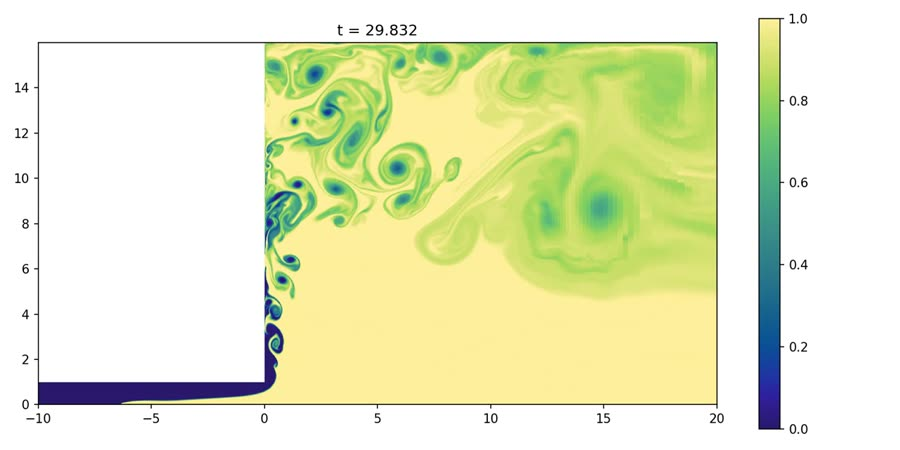
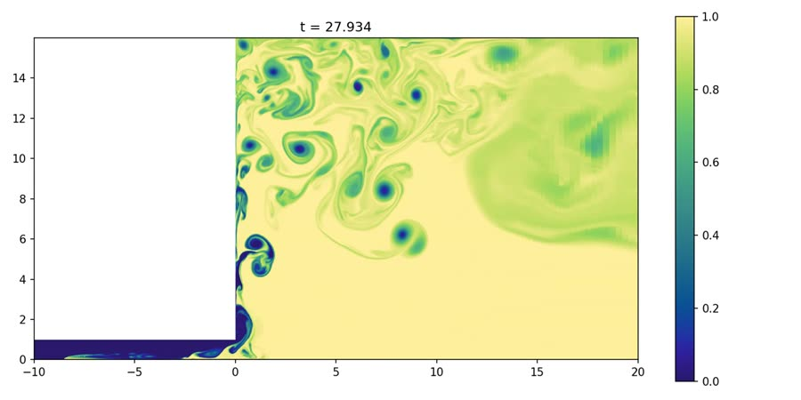
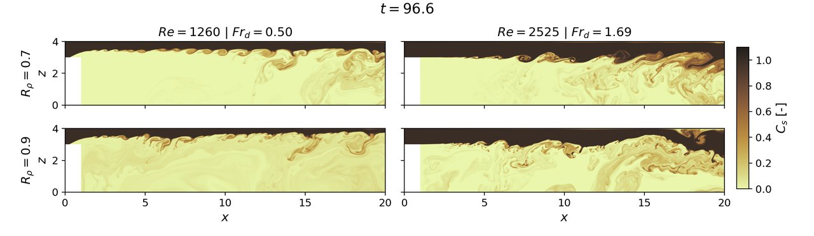
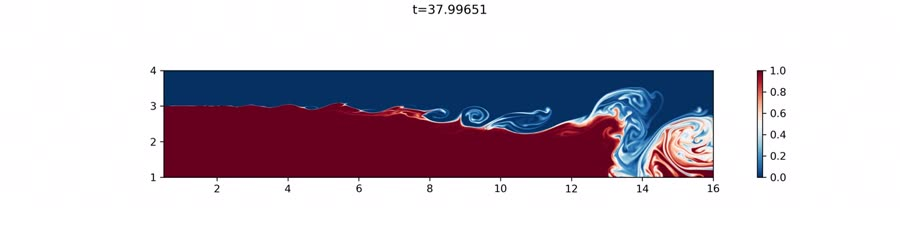
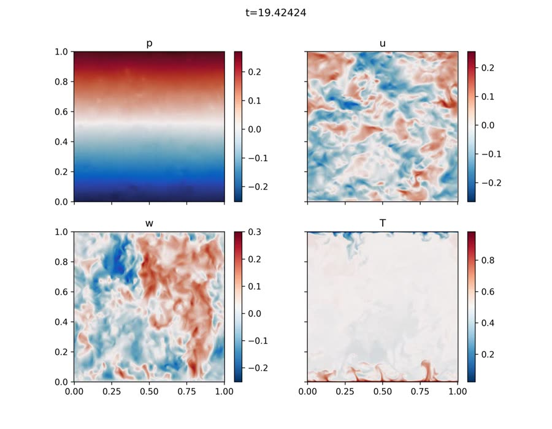
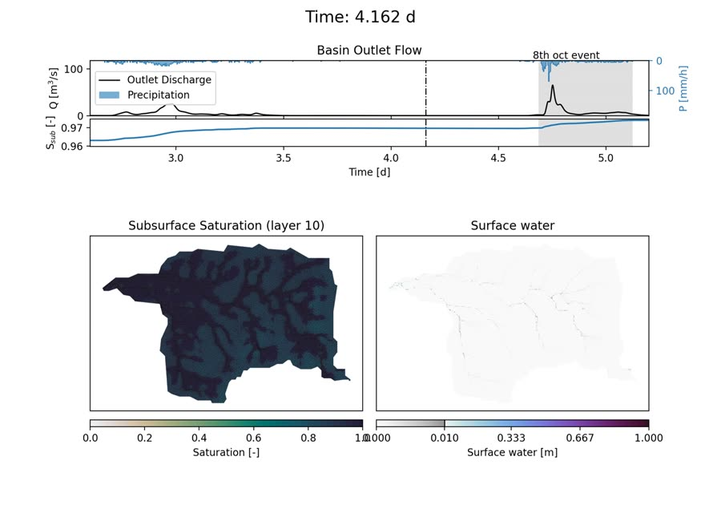

# Simulaciones de flujos ambientales

Videos de simulaciones numéricas de flujos estratificados, plumas y crecidas, desarrolladas por **Tim Redel** en el Departamento de Ingeniería Hidráulica y Ambiental de la Pontificia Universidad Católica de Chile.

**Sitio web:** <https://timoredel.github.io/IAHR26_Redel/>

Este repositorio aloja la página de videos complementarios del póster *Dinámica de las plumas subglaciales y la intrusión de agua de mar en la interfaz hielo-océano*, presentado en el XXXII Congreso Latinoamericano de Hidráulica (IAHR 2026, Valparaíso – Viña del Mar).

---

## Proyectos

### Plumas subglaciales y cuña salina

Simulación numérica directa (DNS) de la descarga de agua dulce desde un canal subglacial hacia un tanque de agua salada, siguiendo los experimentos de Wilson et al. (2020). Bajo el hielo se intruye una cuña salina, y en el frente el agua dulce asciende como una pluma turbulenta junto a la pared de hielo. Las simulaciones 2D comparan un canal horizontal con uno inclinado.

| Canal horizontal (θ = 0°) | Canal inclinado (θ = 8°) |
|---|---|
| [](videos/subglacial/2DRE1333RI037THT00.mp4) | [](videos/subglacial/2DRE1333RI037THT08.mp4) |

Detalle de cada video en [`videos/subglacial`](videos/subglacial/).

### Sedimentación convectiva en plumas fluviales

Proyecto desarrollado durante el **Summer Program 2026 del Center for Turbulence Research (CTR)**, Stanford University. Un canal de agua dulce con sedimentos descarga en un tanque de agua salada (Yuan y Horner-Devine, 2013). En la interfaz compiten los vórtices producidos por el corte y las inestabilidades de Rayleigh–Taylor generadas por la sedimentación.

Subcrítico (*Fr*<sub>d</sub> = 0,50) y supercrítico (*Fr*<sub>d</sub> = 1,69), con razones de densidades *R* = 0,7 (arriba) y 0,9 (abajo):

[](videos/ctr/movie_C_Fr050_Fr169.mp4)

Detalle de cada video en [`videos/ctr`](videos/ctr/).

### Casos adicionales: mezcla turbulenta

Dos flujos de referencia para los mecanismos de mezcla que actúan en las interfaces agua dulce–agua salada: mezcla por corte (inestabilidad de Kelvin–Helmholtz) y mezcla por convección (celdas de Rayleigh–Bénard).

| Kelvin–Helmholtz | Rayleigh–Bénard |
|---|---|
| [](videos/mezcla/RI03RE2525M2.mp4) | [](videos/mezcla/RB_PR1RA09.mp4) |

Detalle de cada video en [`videos/mezcla`](videos/mezcla/).

### Quebrada Honda: crecida del 8 de octubre de 2026

Reconstrucción de la respuesta lluvia-escorrentía de la Quebrada Honda (10,4 km²), aguas arriba de San Carlos de Apoquindo, Santiago, durante la crecida con sedimentos del 8 de octubre de 2026. El modelo ATS (Advanced Terrestrial Simulator) acopla el flujo subsuperficial con la escorrentía superficial. Trabajo en curso con S. Nash, M. Troncoso, S. Muñoz y C. Escauriaza.

[](videos/honda/honda03.mp4)

Detalle en [`videos/honda`](videos/honda/).

---

## Estructura

```
.
├── index.html      página web
├── thumbs/         vista previa de cada video
└── videos/
    ├── subglacial/ plumas subglaciales (2D y 3D)
    ├── ctr/        plumas fluviales con sedimentos
    ├── mezcla/     casos de referencia de mezcla turbulenta
    └── honda/      Quebrada Honda (ATS)
```

## Ver localmente

```bash
python -m http.server 8000
```

y abrir <http://localhost:8000>.

## Referencias

- Wilson, E. A., Wells, A. J., Hewitt, I. J. y Cenedese, C. (2020). The dynamics of a subglacial salt wedge. *J. Fluid Mech.* 895, A20.
- Yuan, Y. y Horner-Devine, A. R. (2013). Laboratory investigation of the impact of lateral spreading on buoyancy flux in a river plume. *J. Phys. Oceanogr.* 43, 2588–2610.

## Contacto

Tim Redel · [tredel@uc.cl](mailto:tredel@uc.cl)
Pontificia Universidad Católica de Chile

Los videos se comparten con fines de difusión académica. Para reutilizarlos, contactar al autor.
